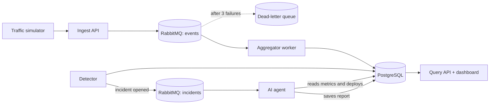

# pulse: Architecture

## Components
| Component | Job |
|---|---|
| Traffic simulator | Sends fake events and injects incidents, so we can test our targets |
| Ingest API | Validates an event, puts it on the queue, replies fast (202) |
| Message queue (RabbitMQ) | Absorbs bursts; failed messages go to a dead-letter queue |
| Aggregator worker | Turns events into one row per service per minute |
| Detector | Every 10 s compares the latest minute with the last 30 minutes |
| AI agent | On an incident, reads metrics and deploys, writes a probable cause |
| Query API + dashboard | Shows charts, incidents, and reports |
| PostgreSQL | Stores everything above |

## Key decisions
1. **Aggregate on the way in.** 1,000 events/sec is 86.4M events/day, but one row per service per minute is only 1,440 rows/day per service.
2. **A queue sits between ingest and storage.** Bursts wait in line instead of crashing the database.
3. **Go for services, PostgreSQL for data.** I already know both.
4. **RabbitMQ for v1.** Durable queues, acknowledgements, and a dead-letter queue are built in, and it runs in one Docker container. Kafka is more than v1 needs.
5. **Simple detection first.** Alert when the latest minute is above the recent average plus 3 standard deviations. No machine learning yet.

## Diagram

## Failure handling
- Worker crashes mid-message: the message is not acknowledged, so it is redelivered.
- Database is down: the queue holds events and the worker retries.
- Bad message: after 3 tries it moves to the dead-letter queue.
- LLM API fails: the alert still fires and the report is marked "pending".

## Open questions (decide later)
- Which LLM and agent approach
- Free hosting options for the queue
- Dashboard technology