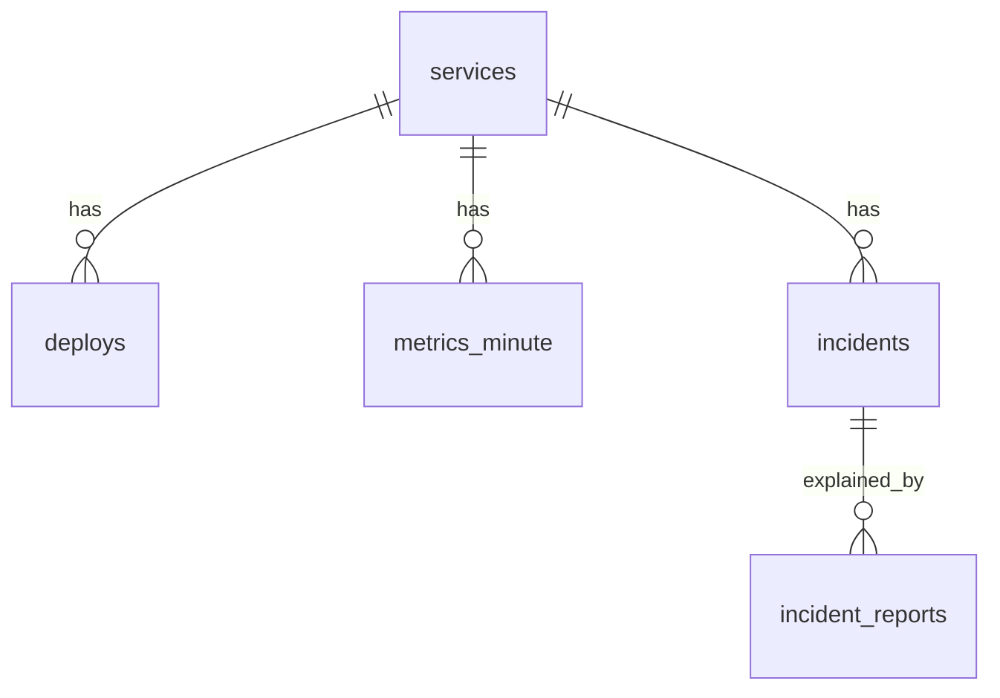

# Database design

## Diagram

## Decisions
1. Store one summary row per service per minute, about 7,200 rows/day for 5 services.
2. The primary key (service_id, bucket_start) enforces one row per minute and speeds up range reads.
3. Latency is a histogram, because histograms can be added across workers and percentiles cannot.
4. Keep 30 days of data, then delete older rows.

## Known gap
If RabbitMQ redelivers a message, the aggregator could count it twice. I will fix this later with a batch id.